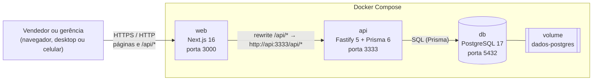
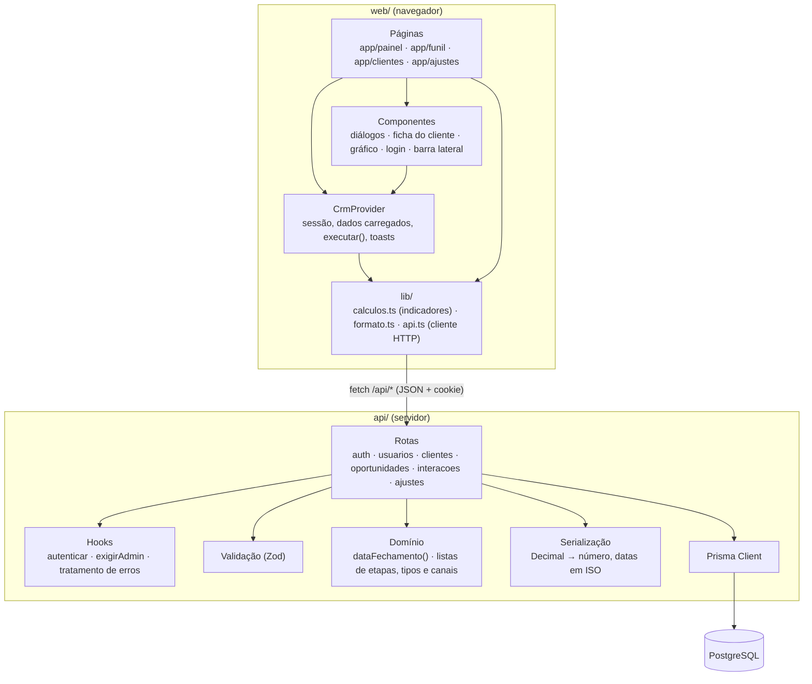
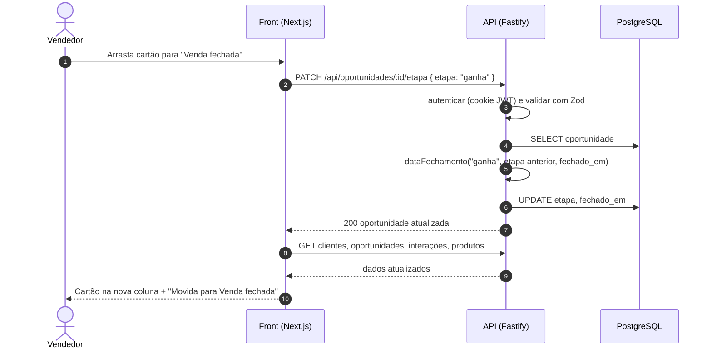
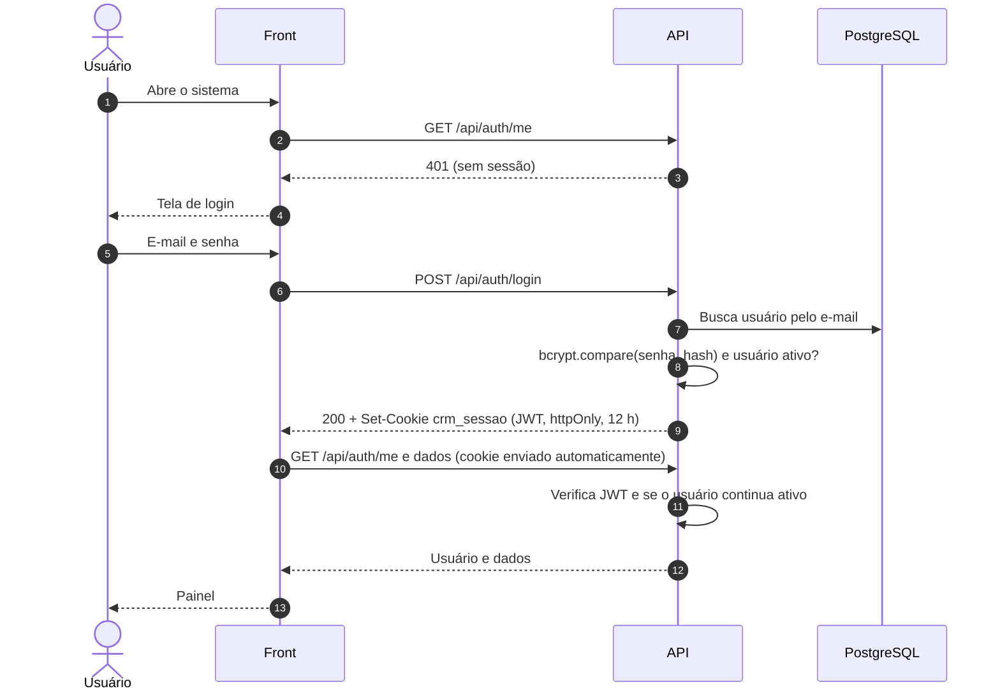
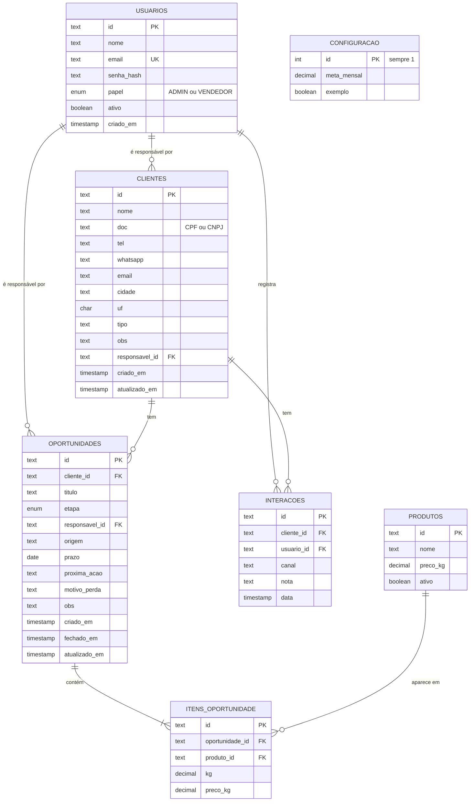
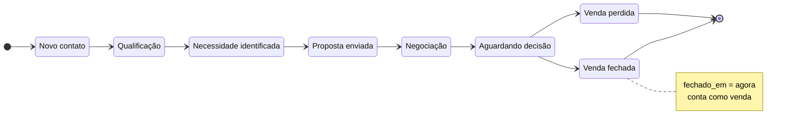
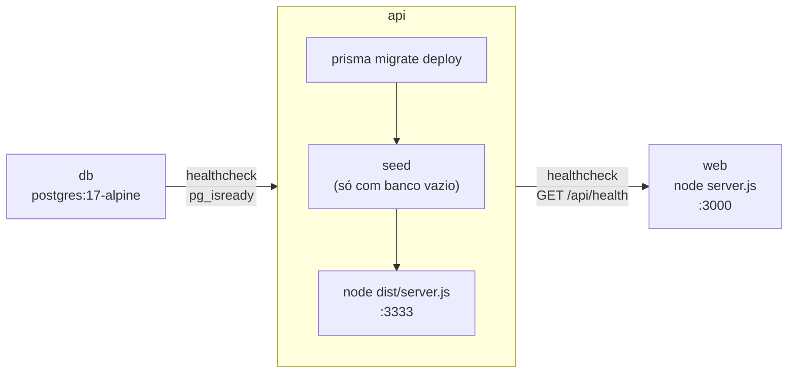

# CRM Casa da Charque — Arquitetura e Funcionalidades

Documentação técnica da **versão 2**: stack, arquitetura, modelo de dados, API e o mapeamento de cada funcionalidade até o código e o banco. Tema, problema, requisitos (RF/RNF) e casos de uso (UC) estão em [documentacao.md](documentacao.md); este documento referencia esses códigos.

## Sumário

1. [Visão geral](#1-visão-geral)
2. [Stack](#2-stack)
3. [Arquitetura](#3-arquitetura)
4. [Autenticação e permissões](#4-autenticação-e-permissões)
5. [Modelo de dados](#5-modelo-de-dados)
6. [Funil de vendas](#6-funil-de-vendas)
7. [API REST](#7-api-rest)
8. [Mapeamento das funcionalidades](#8-mapeamento-das-funcionalidades)
9. [Regras de negócio e cálculos](#9-regras-de-negócio-e-cálculos)
10. [Estrutura do código](#10-estrutura-do-código)
11. [Implantação com Docker](#11-implantação-com-docker)
12. [Segurança, limitações e próximos passos](#12-segurança-limitações-e-próximos-passos)

---

## 1. Visão geral

O CRM organiza o relacionamento comercial da Casa da Charque, distribuidora de charque e carnes salgadas na CEASA de Recife: cadastro de clientes, funil de vendas, registro de contatos, metas e indicadores.

São três serviços:

| Serviço | Responsabilidade |
| --- | --- |
| **Front** (`web/`) | Interface no navegador: telas, formulários, gráficos e cálculos dos indicadores |
| **API** (`api/`) | Regras de negócio, validação, login, permissões e acesso ao banco |
| **Banco** | PostgreSQL com os dados de toda a equipe |

O protótipo **v1** (`crm-casa-da-charque.html`, dados no `localStorage` do navegador) continua no repositório como referência.

## 2. Stack

### Front-end

| Tecnologia | Versão | Uso |
| --- | --- | --- |
| Next.js (App Router) | 16.4 | Rotas das telas, build e servidor de produção (`standalone`) |
| React | 19.3 | Componentes e estado da interface |
| TypeScript | 5.9 | Tipagem de todo o código |
| CSS puro | — | Tokens de cor em `:root`, tema claro/escuro automático, layout responsivo |
| `next/font` | — | Fontes Bricolage Grotesque, Public Sans e IBM Plex Mono |
| SVG | — | Gráfico de vendas mensais, desenhado sem biblioteca |

### Back-end

| Tecnologia | Versão | Uso |
| --- | --- | --- |
| Node.js | 22 (imagem Docker) | Execução da API |
| Fastify | 5.12 | Servidor HTTP e rotas |
| Prisma | 6.19 | ORM, migrações e cliente tipado do banco |
| Zod | 3.25 | Validação dos dados recebidos, com mensagens em português |
| @fastify/jwt + @fastify/cookie | 9.1 / 11.1 | Sessão por JWT em cookie `httpOnly` |
| bcryptjs | 3.0 | Hash das senhas |
| TypeScript | 5.9 | Tipagem; `tsx` no desenvolvimento |

### Dados e infraestrutura

| Tecnologia | Versão | Uso |
| --- | --- | --- |
| PostgreSQL | 17 (alpine) | Banco relacional |
| Docker + Docker Compose | — | Empacotamento e orquestração dos três serviços |

### Por que essa stack

- **Uma linguagem só (TypeScript)** no front e na API: a equipe aprende uma vez, e os tipos do domínio (cliente, oportunidade, etapa) têm o mesmo formato dos dois lados.
- **Fastify + Prisma** é uma combinação enxuta: pouca configuração, migrações versionadas e consultas tipadas.
- **PostgreSQL** tem tipo `DECIMAL` exato para dinheiro e quilos, e é gratuito.
- **Docker** permite subir o sistema inteiro com um comando, igual em qualquer computador ou servidor.

## 3. Arquitetura

### 3.1 Visão de containers



O navegador conversa **só com o front**. O Next repassa tudo que começa com `/api/` para a API dentro da rede do Docker. Com isso:

- o cookie de sessão fica no mesmo endereço das páginas (sem CORS e sem cookie de terceiros);
- a API e o banco não precisam ficar expostos na internet; as portas 3333 e 5432 servem só para desenvolvimento.

### 3.2 Camadas



**Onde cada coisa é calculada:**

| No servidor (API) | No navegador (front) |
| --- | --- |
| Validação dos dados, permissões, senha | Indicadores do painel (vendas do período, ticket médio, conversão, meta, ranking de produtos) |
| Data de fechamento da venda (`fechado_em`) | Situação do cliente (Prospecto, Novo, Recorrente, Inativo) |
| Catálogo: criar, atualizar, inativar produtos | Filtros e buscas das listas |
| Dados de exemplo e preparação do banco | Valor de cada oportunidade (kg × R$/kg) para exibição |

O front carrega todos os dados depois do login (`api.tudo()`) e calcula os indicadores na memória. Para o volume de uma distribuidora (centenas de clientes, alguns milhares de vendas) isso é rápido e simplifica a API. Se o volume crescer muito, os indicadores podem migrar para consultas agregadas no banco sem mudar as telas.

### 3.3 Fluxo de uma alteração

Toda gravação passa por `executar()` no `CrmProvider`: chama a API, recarrega os dados e mostra a mensagem de sucesso ou o erro devolvido pelo servidor.



## 4. Autenticação e permissões

### 4.1 Login e sessão



- A senha nunca é guardada: só o hash bcrypt (custo 10).
- E-mail inexistente e senha errada devolvem a **mesma** mensagem, para não revelar quem tem conta.
- A cada requisição a API confere se o usuário ainda está ativo; desativar alguém em Ajustes corta o acesso na hora.
- Sem sessão válida, qualquer rota protegida devolve `401` e o front volta para a tela de login.

### 4.2 Papéis

| Ação | Vendedor | Gerência (`ADMIN`) |
| --- | :---: | :---: |
| Ver painel, funil, clientes e ajustes | ✔ | ✔ |
| Cadastrar, editar e excluir clientes | ✔ | ✔ |
| Criar, editar, mover e excluir oportunidades | ✔ | ✔ |
| Registrar contatos | ✔ | ✔ |
| Baixar cópia de segurança | ✔ | ✔ |
| Alterar meta mensal | | ✔ |
| Alterar catálogo de produtos | | ✔ |
| Criar usuários, trocar senhas, mudar acesso, desativar | | ✔ |
| Apagar os dados ou recarregar o exemplo | | ✔ |

A regra é aplicada **na API** (`exigirAdmin`, resposta `403`). O front só esconde os botões para quem não tem acesso. A gerência não consegue desativar nem rebaixar o próprio usuário, para não ficar sem nenhum administrador.

## 5. Modelo de dados

Definido em [`api/prisma/schema.prisma`](../api/prisma/schema.prisma); a migração inicial está em `api/prisma/migrations/`.



### Decisões do modelo

| Decisão | Motivo |
| --- | --- |
| Uma **venda** é uma oportunidade na etapa `ganha`; não existe tabela de pedidos | O funil já acompanha o pedido do primeiro contato ao fechamento. A data da venda é `fechado_em` |
| `kg` e `preco_kg` no **item**, não só no produto | O preço negociado em cada venda fica registrado mesmo que o catálogo mude depois |
| Produto removido fica com `ativo = false` | As vendas antigas continuam mostrando o nome do produto (chave estrangeira com `RESTRICT`) |
| `DECIMAL(10,2)` para dinheiro e quilos | Evita erros de arredondamento de ponto flutuante |
| Excluir cliente apaga oportunidades, itens e contatos (`CASCADE`) | O histórico não faz sentido sem o cliente; a tela pede confirmação |
| Desativar ou excluir usuário deixa `responsavel_id` nulo (`SET NULL`) | Clientes e vendas não se perdem quando alguém sai da equipe |
| `prazo` é `DATE`, `fechado_em` é `TIMESTAMP` | Prazo é um dia do calendário; fechamento é um instante |
| `configuracao` com uma linha só (`id = 1`) | Meta mensal e o aviso de dados de exemplo valem para a empresa toda |
| Índices em `etapa`, `cliente_id`, `fechado_em` e `clientes.nome` | São os filtros mais usados pelo funil, pela ficha e pelos relatórios |

### Valores fixos (validados pela API)

| Campo | Valores |
| --- | --- |
| `clientes.tipo` | Varejo, Atacado, Restaurante, Distribuidor, Mercadinho, Feirante |
| `oportunidades.origem` | Balcão CEASA, Indicação, WhatsApp, Instagram, Telefone, Visita do vendedor, Recompra |
| `interacoes.canal` | Ligação, WhatsApp, Visita, E-mail, Balcão |
| `oportunidades.etapa` | enum `Etapa` do banco (ver seção 6) |

## 6. Funil de vendas



O diagrama mostra o caminho típico, mas **qualquer etapa pode ir para qualquer outra** (arrastando no quadro ou editando). A API aplica a regra de fechamento em toda mudança:

| De | Para | `fechado_em` |
| --- | --- | --- |
| Etapa aberta | `ganha` ou `perdida` | Passa a ser a data e hora atual |
| `ganha` | `perdida` (ou o contrário) | Nova data e hora atual |
| `ganha` ou `perdida` | A mesma etapa (edição) | Mantém a data original |
| `ganha` ou `perdida` | Etapa aberta | Volta a ser vazio |

Ao soltar um cartão em **Venda perdida** sem motivo registrado, o formulário abre para preencher o motivo (RF08). As colunas de venda fechada e perdida mostram só os últimos 30 dias.

## 7. API REST

Base: `/api`. Corpo e respostas em JSON. Datas em ISO 8601; `prazo` em `AAAA-MM-DD`. Erros sempre no formato `{ "erro": "mensagem em português" }`.

| Método | Rota | Acesso | Descrição |
| --- | --- | --- | --- |
| `GET` | `/health` | público | Verifica API e banco (usado pelo Docker) |
| `POST` | `/auth/login` | público | `{ email, senha }` → usuário + cookie de sessão |
| `POST` | `/auth/logout` | público | Apaga o cookie |
| `GET` | `/auth/me` | logado | Usuário da sessão |
| `GET` | `/usuarios` | logado | Lista de usuários (sem senha) |
| `POST` | `/usuarios` | gerência | `{ nome, email, senha, papel }` |
| `PATCH` | `/usuarios/:id` | gerência | `{ nome?, papel?, ativo?, senha? }` |
| `GET` | `/clientes` | logado | Lista ordenada por nome |
| `GET` | `/clientes/:id` | logado | Um cliente |
| `POST` | `/clientes` | logado | Cria cliente |
| `PUT` | `/clientes/:id` | logado | Substitui os dados |
| `DELETE` | `/clientes/:id` | logado | Exclui com oportunidades e contatos |
| `GET` | `/oportunidades` | logado | Lista com os itens |
| `POST` | `/oportunidades` | logado | Cria com itens `[{ produtoId, kg, precoKg }]` |
| `PUT` | `/oportunidades/:id` | logado | Substitui campos e itens (transação) |
| `PATCH` | `/oportunidades/:id/etapa` | logado | `{ etapa }`: move no funil |
| `DELETE` | `/oportunidades/:id` | logado | Exclui |
| `GET` | `/interacoes` | logado | Lista, mais recentes primeiro |
| `POST` | `/interacoes` | logado | `{ clienteId, canal, nota }`, registrada em nome de quem está logado |
| `GET` | `/produtos` | logado | Todos, inclusive inativos |
| `PUT` | `/produtos` | gerência | Recebe o catálogo inteiro; cria, atualiza e inativa |
| `GET` | `/configuracao` | logado | `{ metaMensal, exemplo }` |
| `PUT` | `/configuracao` | gerência | `{ metaMensal }` |
| `GET` | `/backup` | logado | Todos os dados em JSON, como arquivo para baixar (sem senhas) |
| `POST` | `/admin/reset` | gerência | `{ modo: "zerar" }` ou `{ modo: "exemplo" }` |

**Códigos de resposta:**

| Código | Quando |
| --- | --- |
| `200` / `201` / `204` | Sucesso (`201` ao criar, `204` sem corpo) |
| `400` | Dados inválidos (Zod) ou referência a cliente/produto/usuário inexistente |
| `401` | Sem sessão, sessão expirada ou usuário desativado |
| `403` | Ação exclusiva da gerência |
| `404` | Registro não encontrado |
| `409` | E-mail já cadastrado |
| `500` | Erro inesperado (registrado no log da API) |

## 8. Mapeamento das funcionalidades

Cada linha liga a funcionalidade ao requisito e caso de uso de [documentacao.md](documentacao.md), à tela e ao código do front, à rota da API e às tabelas.

### 8.1 Acesso

| Funcionalidade | RF / UC | Tela e componente | API | Tabelas |
| --- | --- | --- | --- | --- |
| Entrar com e-mail e senha | RNF06 | Login · `components/login.tsx` | `POST /auth/login` | `usuarios` |
| Manter sessão ao recarregar | RNF06 | `components/crm-provider.tsx` | `GET /auth/me` | `usuarios` |
| Sair | RNF06 | Barra lateral · `components/sidebar.tsx` | `POST /auth/logout` | — |

### 8.2 Painel comercial (`/painel`)

Arquivo: `web/app/painel/page.tsx`. Os indicadores são calculados no front (`lib/calculos.ts`) a partir dos dados carregados.

| Funcionalidade | RF / UC | Como é calculado | Dados |
| --- | --- | --- | --- |
| Filtro de período (este mês, mês passado, 90 dias, ano) | RF09 · UC08 | `periodo()` | — |
| Vendas do período | RF09 · UC08 | Soma de kg × R$/kg das oportunidades `ganha` com `fechadoEm` no período | `oportunidades`, `itens_oportunidade` |
| Ticket médio | RF09 | Vendas do período ÷ número de pedidos | idem |
| Taxa de conversão | RF09 | Ganhas ÷ (ganhas + perdidas) fechadas no período | idem |
| Propostas abertas | RF09 | Oportunidades em `proposta` ou `negociacao` e valor somado | `oportunidades` |
| Aguardando retorno | RF09 | Oportunidades em `aguardando` e valor somado | `oportunidades` |
| Clientes novos × recorrentes | RF09 | Compradores do período sem compra anterior × com compra anterior | `oportunidades` |
| Meta do mês, % atingido e quanto vender por dia | RF10 | Vendas do mês ÷ meta; (meta − vendido) ÷ dias restantes | `configuracao` |
| Gráfico dos últimos 6 meses com linha da meta | RF10 | `components/grafico-mensal.tsx` (SVG) | `oportunidades`, `configuracao` |
| Produtos mais vendidos (kg e R$) | RF09 | Soma dos itens por produto, 6 maiores em kg | `itens_oportunidade`, `produtos` |
| Próximas ações, atrasadas em destaque | RF12 · UC07 | Oportunidades abertas ordenadas por prazo; prazo < hoje = atrasada | `oportunidades` |
| Oportunidades de recompra | RF11 · UC06 | Clientes com compra há mais de 30 dias e nenhuma oportunidade aberta | `clientes`, `oportunidades` |
| Criar oportunidade de recompra | RF11 · UC06 | Abre o formulário com os itens do último pedido e os preços atuais do catálogo; salva com `POST /oportunidades` | `oportunidades`, `itens_oportunidade` |
| Nova oportunidade | RF05 · UC04 | Abre o formulário (seção 8.3) | — |

### 8.3 Funil de vendas (`/funil`)

Arquivos: `web/app/funil/page.tsx`, `web/components/oportunidade-dialog.tsx`.

| Funcionalidade | RF / UC | Front | API | Tabelas |
| --- | --- | --- | --- | --- |
| Quadro com 8 etapas, contagem e valor por coluna | RF06 | `FunilPage` | `GET /oportunidades` | `oportunidades`, `itens_oportunidade` |
| Total em negociação (etapas abertas) | RF06 | `FunilPage` | — | — |
| Arrastar cartão entre etapas | RF07 · UC05 | Eventos `dragstart`/`drop` | `PATCH /oportunidades/:id/etapa` | `oportunidades` |
| Pedir motivo ao perder a venda | RF08 · UC05 | Abre o formulário após soltar em "Venda perdida" | `PUT /oportunidades/:id` | `oportunidades` |
| Filtro por vendedor e busca por cliente | RF06 | Estado local da página | — | — |
| Cartão atrasado em destaque | RF12 | `atrasada()` | — | — |
| Criar oportunidade | RF05 · UC04 | `OportunidadeDialog` | `POST /oportunidades` | `oportunidades`, `itens_oportunidade` |
| Editar oportunidade (clique no cartão) | RF05 · RF07 | `OportunidadeDialog` | `PUT /oportunidades/:id` | idem |
| Produtos com kg × R$/kg e valor estimado ao vivo | RF05 | Linhas de item no formulário; preço sugerido do catálogo | — | `produtos` |
| Excluir oportunidade (com confirmação) | RNF07 | `ConfirmButton` | `DELETE /oportunidades/:id` | `oportunidades` |

### 8.4 Clientes (`/clientes`)

Arquivos: `web/app/clientes/page.tsx`, `web/components/cliente-form-dialog.tsx`, `web/components/cliente-drawer.tsx`.

| Funcionalidade | RF / UC | Front | API | Tabelas |
| --- | --- | --- | --- | --- |
| Lista com tipo, cidade, responsável, último contato, pedidos e total comprado | RF01 | `ClientesPage` | `GET /clientes` | `clientes`, `oportunidades` |
| Busca por nome, CPF/CNPJ, cidade ou telefone | RF01 | Estado local | — | — |
| Filtro por tipo e por situação | RF02 | `statusCliente()` | — | — |
| Cadastrar cliente | RF01 · UC01 | `ClienteFormDialog` | `POST /clientes` | `clientes` |
| Editar cliente | RF01 · UC01 | `ClienteFormDialog` | `PUT /clientes/:id` | `clientes` |
| Excluir cliente com histórico (com confirmação) | RF01 · RNF07 | `ConfirmButton` | `DELETE /clientes/:id` | `clientes` (cascata) |
| Ficha: total comprado, pedidos, ticket médio, última compra | RF03 · UC02 | `ClienteDrawer` | — | `oportunidades` |
| Ficha: dados de contato e link do WhatsApp | RF03 | `ClienteDrawer` (`wa.me`) | — | `clientes` |
| Ficha: oportunidades em aberto e histórico de compras | RF03 · UC02 | `ClienteDrawer` | — | `oportunidades`, `itens_oportunidade` |
| Registrar contato (ligação, WhatsApp, visita, e-mail, balcão) | RF04 · UC03 | Formulário na ficha | `POST /interacoes` | `interacoes` |
| Linha do tempo de contatos com quem registrou | RF04 | `ClienteDrawer` | `GET /interacoes` | `interacoes`, `usuarios` |
| Nova oportunidade a partir da ficha | RF05 | Botão na ficha | `POST /oportunidades` | `oportunidades` |

### 8.5 Ajustes (`/ajustes`)

Arquivo: `web/app/ajustes/page.tsx`.

| Funcionalidade | RF / UC | Acesso | API | Tabelas |
| --- | --- | --- | --- | --- |
| Meta de vendas mensal | RF10 · UC09 | gerência | `PUT /configuracao` | `configuracao` |
| Lista de vendedores e acessos | RF13 · UC09 | todos veem | `GET /usuarios` | `usuarios` |
| Criar usuário com senha inicial e papel | RF13 · RNF06 | gerência | `POST /usuarios` | `usuarios` |
| Trocar senha, mudar papel, desativar e reativar | RF13 · RNF06 | gerência | `PATCH /usuarios/:id` | `usuarios` |
| Catálogo de produtos com preço por kg | RF13 · UC09 | gerência | `PUT /produtos` | `produtos` |
| Baixar cópia de segurança (JSON) | RF14 · UC10 | todos | `GET /backup` | todas |
| Apagar dados e começar do zero (com confirmação) | RNF07 | gerência | `POST /admin/reset` `zerar` | `clientes`, `oportunidades`, `itens_oportunidade`, `interacoes` |
| Recarregar dados de exemplo (com confirmação) | — | gerência | `POST /admin/reset` `exemplo` | idem + `produtos`, `configuracao` |

> **RF14 (restaurar cópia):** na v2 a cópia é só para download. A restauração passa a ser feita pelo banco (`pg_dump` / `pg_restore`), que é mais seguro do que colar um JSON na tela. Ver seção 12.

### 8.6 Funcionalidades transversais

| Funcionalidade | RF / RNF | Onde |
| --- | --- | --- |
| Interface em português, R$, dd/mm/aaaa e kg | RNF02 | `web/lib/formato.ts` (`Intl.NumberFormat` e `toLocaleDateString` em `pt-BR`) |
| Layout responsivo a partir de 375 px | RNF03 | `web/app/globals.css` (barra lateral vira faixa superior abaixo de 760 px) |
| Tema claro e escuro automático | — | `globals.css`, `prefers-color-scheme` |
| Aviso de dados de exemplo | — | `components/banner-exemplo.tsx`, `configuracao.exemplo` |
| Mensagens de confirmação e de erro | RNF07 | `CrmProvider.toast()`, mensagens de erro vindas da API |
| Confirmação em duas etapas para excluir | RNF07 | `components/modal.tsx` → `ConfirmButton` |

## 9. Regras de negócio e cálculos

| Regra | Definição | Onde |
| --- | --- | --- |
| Venda | Oportunidade na etapa `ganha`; data da venda = `fechado_em` | API e front |
| Valor da oportunidade | Soma de `kg × preco_kg` dos itens | `web/lib/calculos.ts` → `valorOp()` |
| Data de fechamento | Ver tabela da seção 6 | `api/src/dominio.ts` → `dataFechamento()` |
| Situação do cliente | Sem compras = **Prospecto**; última compra há mais de 45 dias = **Inativo**; 1 compra = **Novo**; 2 ou mais = **Recorrente** | `web/lib/calculos.ts` → `statusCliente()` |
| Último contato | O mais recente entre contatos registrados e criação/fechamento de oportunidades | `ultimoContato()` |
| Oportunidade atrasada | Etapa aberta com prazo anterior a hoje | `atrasada()` |
| Recompra | Cliente com compra há mais de 30 dias e nenhuma oportunidade aberta | `web/app/painel/page.tsx` |
| Meta no ritmo | % da meta ≥ % do mês já passado → verde; abaixo → amarelo | Painel |
| Conversão | Ganhas ÷ (ganhas + perdidas) encerradas no período | Painel |
| Meta dos dados de exemplo | Média dos 3 últimos meses fechados + 15%, arredondada para múltiplos de R$ 5 mil (mínimo R$ 10 mil) | `api/src/exemplo.ts` |

## 10. Estrutura do código

```text
crm-casa-da-charque/
├── docker-compose.yml          # db + api + web
├── .env.example                # variáveis do Compose (senhas, segredo, seed)
├── crm-casa-da-charque.html    # protótipo v1 (referência)
├── docs/
│   ├── documentacao.md         # projeto: problema, requisitos, casos de uso, backlog
│   └── arquitetura.md          # este documento
├── api/
│   ├── Dockerfile
│   ├── docker-entrypoint.sh    # migrate deploy → seed → servidor
│   ├── prisma/
│   │   ├── schema.prisma       # modelo de dados
│   │   └── migrations/         # migrações SQL versionadas
│   └── src/
│       ├── server.ts           # inicia o Fastify
│       ├── app.ts              # plugins, tratamento de erros, registro das rotas
│       ├── auth.ts             # JWT em cookie, autenticar, exigirAdmin
│       ├── env.ts              # leitura e validação das variáveis de ambiente
│       ├── db.ts               # Prisma Client
│       ├── dominio.ts          # etapas, tipos, canais, regra de fechamento
│       ├── serializar.ts       # formato JSON das respostas
│       ├── exemplo.ts          # gerador dos dados de demonstração
│       ├── seed.ts             # prepara o banco vazio
│       └── rotas/              # auth, usuarios, clientes, oportunidades, interacoes, ajustes
└── web/
    ├── Dockerfile
    ├── next.config.ts          # output standalone + rewrite /api
    ├── public/                 # logo
    ├── app/
    │   ├── layout.tsx          # fontes, CrmProvider, barra lateral
    │   ├── globals.css         # tokens de cor, tema escuro, estilos de todas as telas
    │   ├── icon.png            # ícone da aba
    │   └── painel/ funil/ clientes/ ajustes/   # uma página por tela
    ├── components/
    │   ├── crm-provider.tsx    # sessão, dados, executar(), diálogos, toasts
    │   ├── login.tsx · sidebar.tsx · banner-exemplo.tsx
    │   ├── oportunidade-dialog.tsx · cliente-form-dialog.tsx · cliente-drawer.tsx
    │   ├── grafico-mensal.tsx
    │   └── modal.tsx           # <dialog> nativo e ConfirmButton
    └── lib/
        ├── api.ts              # cliente HTTP e conversão de datas
        ├── tipos.ts            # tipos do domínio
        ├── calculos.ts         # indicadores e regras de exibição
        ├── constantes.ts       # etapas, tipos, origens, canais
        └── formato.ts          # moeda, números e datas em pt-BR
```

## 11. Implantação com Docker

### 11.1 Ordem de subida



1. O **db** sobe e só é considerado pronto quando `pg_isready` responde.
2. A **api** aplica as migrações pendentes, roda o seed (que não faz nada se já houver usuários) e inicia o servidor. Fica pronta quando `/api/health` consegue consultar o banco.
3. O **web** sobe depois da API pronta.

### 11.2 Imagens

| Imagem | Build | Execução |
| --- | --- | --- |
| `api` | `node:22-alpine`: `npm ci`, `prisma generate`, `tsc`, remove dependências de desenvolvimento | `node:22-alpine` com `openssl`, usuário `node` sem privilégios |
| `web` | `node:22-alpine`: `npm ci`, `next build` com `API_URL=http://api:3333` | Servidor `standalone` do Next com `.next/static` e `public/`, usuário `node` |

O endereço da API é gravado no build do front (o rewrite do Next é resolvido em tempo de build). Para mudar, altere o `build.args.API_URL` no `docker-compose.yml` e reconstrua.

### 11.3 Variáveis de ambiente

Definidas num arquivo `.env` ao lado do `docker-compose.yml` (modelo em [`.env.example`](../.env.example)).

| Variável | Serviço | Padrão | Função |
| --- | --- | --- | --- |
| `POSTGRES_PASSWORD` | db, api | `crm` | Senha do banco |
| `JWT_SECRET` | api | valor de desenvolvimento | Assina as sessões (mínimo 16 caracteres) |
| `COOKIE_SECURE` | api | `false` | `true` quando houver HTTPS |
| `SEED_ADMIN_EMAIL` | api | `gerencia@casadacharque.local` | E-mail do primeiro usuário da gerência |
| `SEED_SENHA` | api | valor de desenvolvimento | Senha inicial da gerência e dos vendedores de exemplo |
| `SEED_EXEMPLO` | api | `true` | Carrega os dados fictícios na primeira subida |
| `TZ` | todos | `America/Recife` | Fuso horário dos containers |

### 11.4 Dados persistentes

O banco fica no volume `dados-postgres`. `docker compose down` mantém os dados; `docker compose down -v` apaga tudo. Para cópia do banco:

```bash
docker compose exec db pg_dump -U crm crm > backup.sql
```

## 12. Segurança, limitações e próximos passos

### O que já está protegido

- Senhas com bcrypt; nunca saem da API (nem no `/backup`).
- Sessão em cookie `httpOnly` e `SameSite=Lax`, inacessível ao JavaScript da página.
- Permissões verificadas no servidor em toda requisição, incluindo se o usuário segue ativo.
- Toda entrada validada com Zod; o Prisma usa consultas parametrizadas (sem SQL montado à mão).
- Banco acessível só pela rede interna do Docker e pela máquina local.
- Containers rodando com usuário sem privilégios.

### Limitações conhecidas

| Limitação | Impacto | Sugestão |
| --- | --- | --- |
| Sem limite de tentativas no login | Senhas fracas podem ser descobertas por tentativa e erro se o sistema estiver na internet | `@fastify/rate-limit` na rota de login |
| Sem HTTPS próprio | Em rede aberta a sessão pode ser interceptada | Colocar atrás de um proxy com HTTPS (Caddy, Nginx, Cloudflare) e usar `COOKIE_SECURE=true` |
| Credenciais de desenvolvimento no `.env.example` | Quem subir sem `.env` usa senha conhecida | Trocar `SEED_SENHA`, `JWT_SECRET` e `POSTGRES_PASSWORD` antes de usar dados reais |
| Restauração da cópia só pelo banco | A gerência não restaura pela tela | Rotina de `pg_dump` agendada; se necessário, rota de importação para a gerência |
| Indicadores calculados no navegador | Com dezenas de milhares de vendas o carregamento inicial fica pesado | Mover os indicadores para consultas agregadas na API |
| Sem testes automatizados nem CI | Regressões só aparecem testando à mão | Testes da API com `fastify.inject` e um workflow do GitHub Actions |
| Sem registro de quem alterou cada oportunidade | Não há auditoria de mudanças | Tabela de histórico de etapas |

### Próximos passos (do backlog)

Integração com WhatsApp, emissão de pedidos e controle de estoque, integração com ERP/financeiro, follow-up automático e análise de clientes com IA, conforme o [cronograma](documentacao.md#cronograma-inicial).
